<p align="center">
  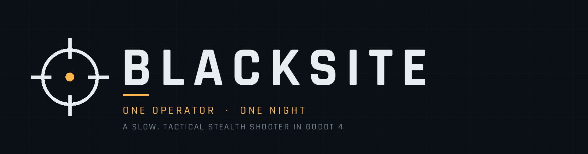
</p>

<p align="center">
  <a href="https://github.com/nuxdie/blacksite/releases/latest"></a>
  <a href="https://github.com/nuxdie/blacksite/actions/workflows/test.yml"></a>
  
  
</p>

A tactical stealth shooter in Godot 4.7. One operator, one night: recover a drive from a guarded compound and get out.

It is slow and lethal. Guards build awareness from light, distance, movement and sound, and radio each other on a net that HQ runs. Nothing regenerates, nothing is hacked through the air, and every consequence lasts the rest of the night. No crosshair, no hitmarkers, no controls screen: the keys appear when they matter.

<table>
  <tr>
    <td>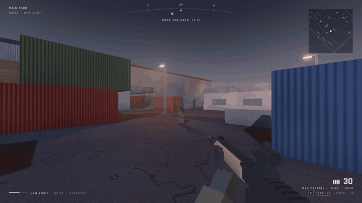</td>
    <td>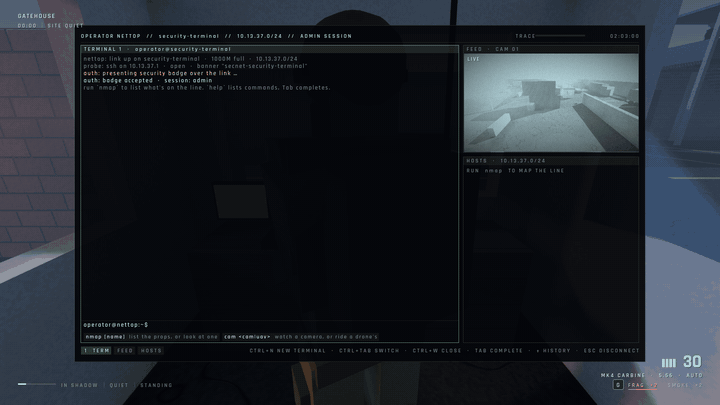</td>
  </tr>
  <tr>
    <td align="center"><sub>Standing in the light. The arcs show who is noticing you and the line says why. Then the call goes out.</sub></td>
    <td align="center"><sub>Cable the nettop to a port, map what is on the line, and ride a camera.</sub></td>
  </tr>
  <tr>
    <td>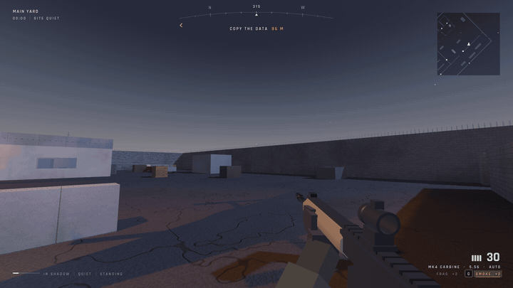</td>
    <td>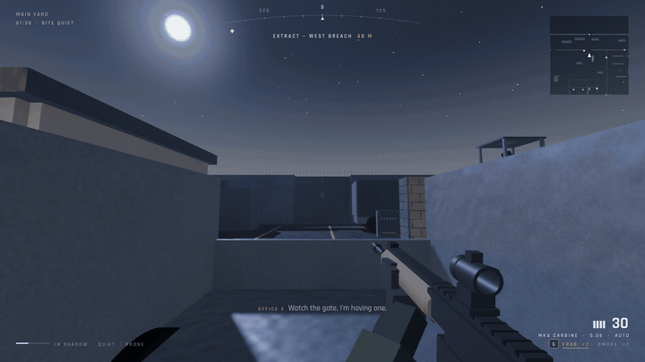</td>
  </tr>
  <tr>
    <td align="center"><sub>Equipment is thrown off an arc preview. Smoke is a real volume that blocks their sight, not their bullets.</sub></td>
    <td align="center"><sub>The delivery truck comes and goes through the vehicle gate. Lie flat in the bed and it carries you out.</sub></td>
  </tr>
</table>

## Download

Linux x86_64 builds are on the [releases page](https://github.com/nuxdie/blacksite/releases/latest). Unpack and run `./blacksite`. The first launch synthesizes the sound bank, which takes a few seconds. Settings and quicksaves live under `~/.local/share/godot/app_userdata/Blacksite/`.

Every tag that starts with `v` is built by GitHub Actions ([release.yml](.github/workflows/release.yml)) from a clean checkout: it downloads Godot and the export templates, exports the Linux preset, runs the in-engine autotest against the exported binary, and attaches the archive to the release. Every push to `main` runs the same autotest ([test.yml](.github/workflows/test.yml)).

## Screenshots

<table>
  <tr>
    <td>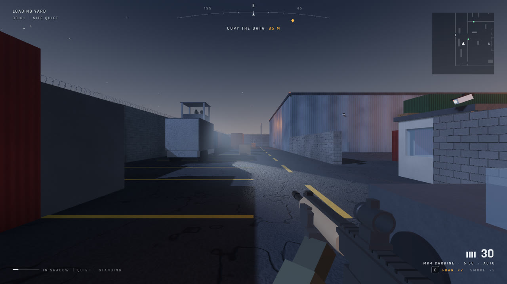</td>
    <td>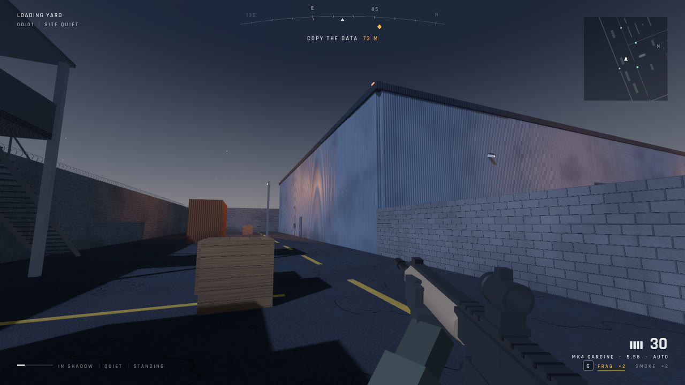</td>
  </tr>
  <tr>
    <td>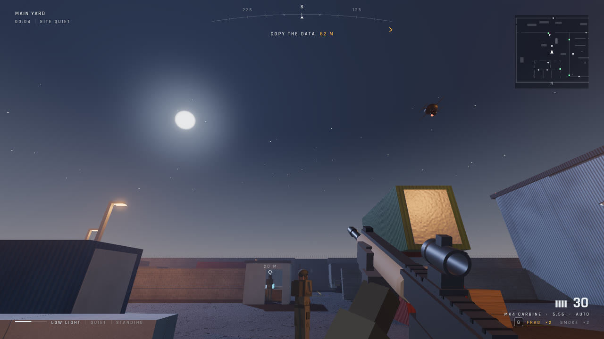</td>
    <td>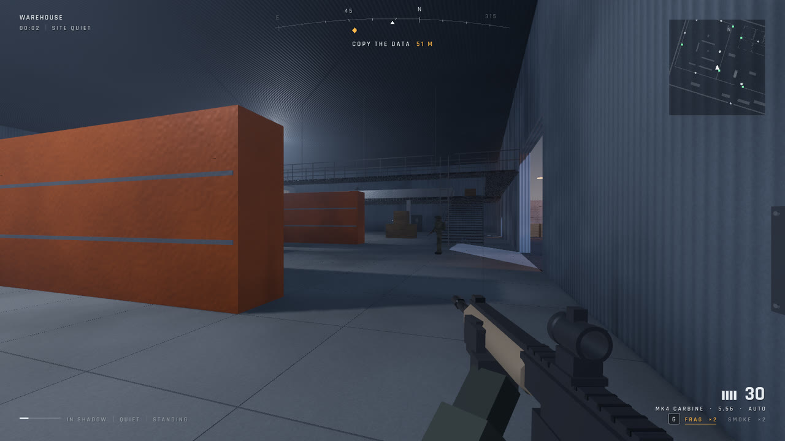</td>
  </tr>
  <tr>
    <td>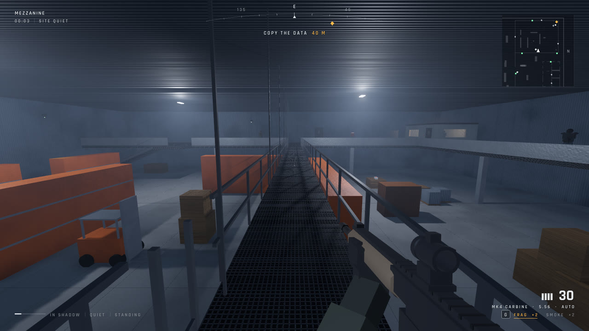</td>
    <td>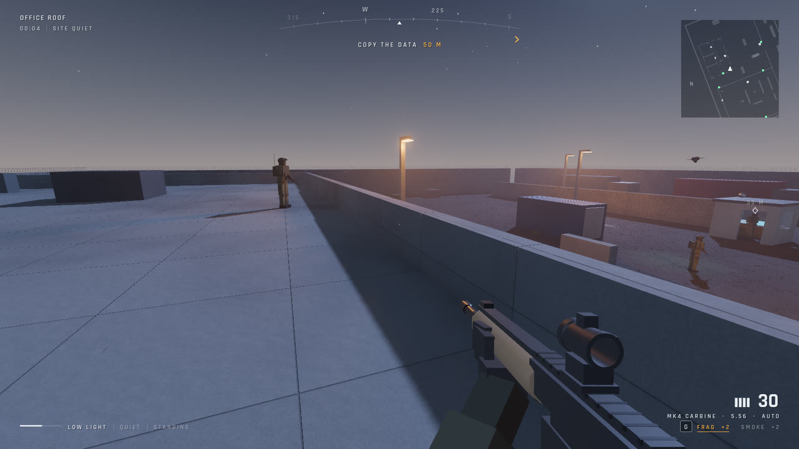</td>
  </tr>
  <tr>
    <td>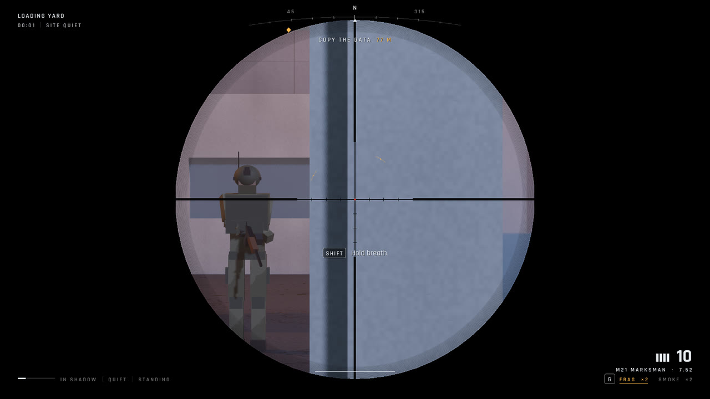</td>
    <td>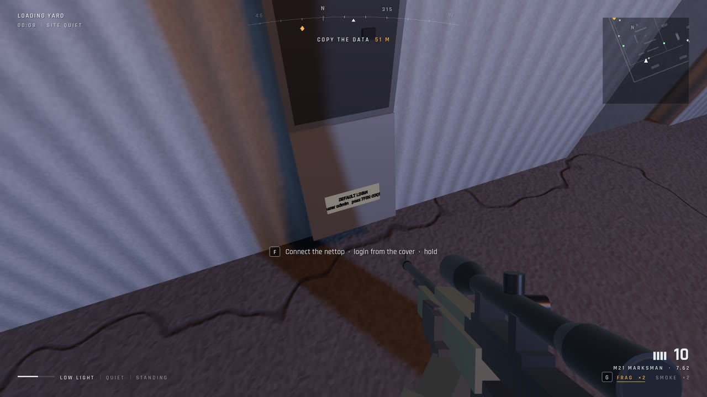</td>
  </tr>
  <tr>
    <td>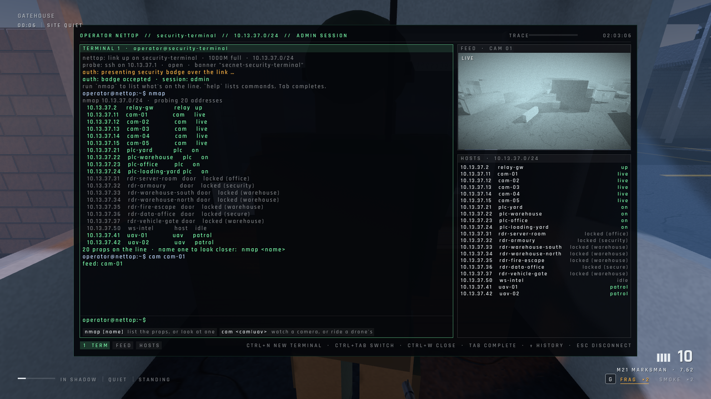</td>
    <td>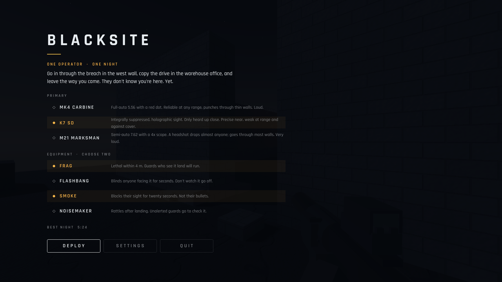</td>
  </tr>
</table>

## Run

```sh
GODOT=~/Applications/Godot/Godot_v4.7.2-stable_linux.x86_64
$GODOT --path .        # play
$GODOT -e --path .     # open in the editor
```

The first launch synthesizes every sound effect and caches it under `user://` (a few seconds). The navigation mesh is baked at load. On a fresh clone run `$GODOT --headless --path . --import` once (or open the editor) so Godot registers the script classes.

There is no controls screen to memorize. Keys appear on screen when they become useful, and one-time tips teach the rest as situations come up. A reference sheet lives in the pause menu (Esc), along with sensitivity and a button to replay the tips.

## Layout

```
project.godot            input actions are registered at runtime by Settings
scenes/                  main, player, soldier
scripts/core/            Settings (autoload), Sfx (autoload) + Synth, Lines (the spoken-line catalogue), physics layers
scripts/world/           Facility (level, lighting, navmesh), Lamp, Pickup, Mats (materials + penetration table)
scripts/combat/          WeaponData resource, Ballistics (penetrating hitscan), Gadget (thrown equipment)
scripts/player/          Player (movement, stance, lean, vault, wounds), Weapons (mags, chamber, fire, throw),
                         GunModels (procedural guns built around their sight lines), ViewModel (animation)
scripts/ai/              Soldier (perception + behaviour), SoldierModel, SoldierProfile resource, Squad, Cover
scripts/game/            Game (mission flow and shared rules), Command (HQ: alert level, radio checks, alarm), TestRunner
scripts/ui/              Hud, Hints (contextual teaching), Menu, Style
shaders/                 procedural world surfaces, night sky, screen stress effects
resources/weapons/       carbine, smg, dmr, pistol (.tres — tune here)
resources/soldiers/      rifleman, heavy, breacher (.tres — tune here)
assets/fonts/            Rajdhani (SIL OFL, see OFL.txt)
assets/voice/            lines.json (every spoken line) and the rendered takes, one folder per voice
tools/voices/            render.py: regenerates assets/voice with Piper (see below)
tools/media/             banner.py (logo and banner) and build.sh (README stills and GIFs from a --media capture)
docs/media/              the images this README shows
.github/workflows/       test.yml runs the autotest on every push; release.yml builds the Linux export for tags
```

## Interface

The HUD is one overlay with four quiet corners and an empty centre. Top left: where you are and the state of the site (quiet, caution, alarm, reaction-force timer, their radio down, trace). Top centre: a heading arc with the objective riding on it and its distance. Centre: nothing until someone notices you; then arcs point at whoever is interested, a line above the sights says why (lit, too close, in their view, too loud, on camera, spotted), and the edges of the frame warm amber or red. Bottom left: how visible you are, how far your footsteps carry, your stance, and your wounds while they matter. Bottom right: what is in your hands, shown only while it is low or changing, and your equipment. Key prompts appear in the centre when they apply; one-time tips teach the rest. Guards speak with their callsigns under their lines; radio traffic carries the three-arc mark.

## Sound

Everything you can see is also said in the mix. Guards speak: six rendered voices, shouted lines heard in person and squad-net lines heard through the nearest radio (a guard's, or a body's), cut off if the speaker dies mid-sentence. HQ runs radio checks that every living guard answers by callsign, and opens priority traffic (caution, alarm, stand-down, reaction force) with a two-tone alert. The security desk calls out cameras and drones. Being noticed is a rising note from where the watcher stands; being written off is a falling one; being spotted is a sting. A soft bed sits under the mix while someone is interested in you and a pulsing one while you are hunted. Indoors swaps wind for ventilation. Machines keep making their noise: searchlight motors, camera pan servos, the laptop copying, the terminal hum, trace warnings, drone scan pings and lock tones, badge readers, maglocks, breakers, power dropping out, the relay dying and coming back.

Volumes (master, effects, voices, ambience) and subtitles live in Settings.

### Regenerating the voices

Lines are in `assets/voice/lines.json`; the game reads them from there, so changing a line means re-rendering its audio:

```sh
python3 -m venv ~/.venv/piper && ~/.venv/piper/bin/pip install piper-tts
~/.venv/piper/bin/python -m piper.download_voices --data-dir ~/piper-voices \
    en_US-joe-medium en_GB-northern_english_male-medium en_US-arctic-medium en_GB-alan-medium en_US-ryan-high
~/.venv/piper/bin/python tools/voices/render.py --voices ~/piper-voices
```

Needs `sox` and `ffmpeg`. Existing takes are skipped, so delete a file to re-render it.

## Systems at a glance

- **Insertion**: you start outside the west wall and go in through a breach; extraction is back out the same hole.
- **Zones and routes**: every area has a job, and most have more than one way in.
  - *Loading yard*: insertion, vehicles for cover, a watchtower with a guard and a sweeping searchlight, a ladder onto a container for a perch, and a crate to get over the wall into the main yard.
  - *Gatehouse*: the security booth, its badge holder and the camera terminal.
  - *Main yard*: the open crossing, patrolled and lit.
  - *Office*: the server room (office access, maglock, or crawl in through a vent duct from the west alley), the armoury (security access, or drop in through the roof hatch), and the comms relay on the roof, reached by stairs.
  - *Warehouse*: the objective. The loading doors are open but lit; the south and north doors take a warehouse badge; a fire escape climbs the east alley to the mezzanine; catwalks cross the bay, with a ladder up from the floor. The data office needs secure access, or a climb through its window.
  - *Outside the wire*: a dark perimeter path to a crawl-through culvert under the north wall.
- **Doors**: RFID readers with access levels taken from guards' badges. Cutting a zone's power opens maglock doors and kills strike-locked readers. Guards badge through, so you can follow one.
- **Vertical travel**: stairs and catwalks for everyone; ladders climbed with the interact key, and by guards along navigation links; ducts are crouch-only and loud on sheet metal.
- **Drones**: two security quadrotors fly automated patrols, scanning the ground like moving cameras with a visible light cone. A drone that locks on raises the alarm and tracks you for the guards. They run on the security network, so cutting comms grounds them (they fly home) and an EMP drops one for a while; they are also shootable. A camera alarm or guard contact vectors the nearest patrolling drone to look.
- **Fair detection**: light only counts if it reaches you (walls block lamps, flashlights and the searchlight); closed doors and grilles block sight; footsteps carry half as far through walls. The status line always says why you are being noticed: lit, too close, in view, too loud, or on camera.
- **Sights**: no crosshair. Each gun is modelled so its sight line is exact: red dot (MK4), holographic ring (K7), 3-dot tritium night sights (P9), AK notch and post, LMG peep, shotgun bead, and a 4x scope whose eye-box shadow drifts when you move or breathe.
- **Weapon handling**: closed-bolt guns keep one in the chamber on a tactical reload (30+1); empty reloads need the bolt worked. The pistol slide locks back empty. The shotgun is pumped after every shot and loads shell by shell; firing stops the reload.
- **Wounds**: nothing regenerates. Hits bleed until you bandage (T); a leg hit stops you running until a medkit splints it.
- **Consequences**: HQ runs the radio net. Guards check in every ~95 s, and a dead guard (hidden or not) doesn't answer, so HQ sends people to their post and the site goes to *caution* for the rest of the night (sharper eyes, flashlights, longer searches, scanning posts). A spotted intruder that gets radioed in raises the *alarm*: siren, the nearest guards sent, and a reaction force 70 s later. Kill the spotter before the call goes out (about 3 s), or take the relay down, and HQ never hears it. Without radios, guards still shout to anyone in earshot. Guards walk back to their posts after a search and limp after leg hits.
- **Marking**: a marked guard is tracked only while you can see them; otherwise you keep where you last saw them.

- **Stealth**: guards build awareness from distance, light (lamps, moonlight, their own flashlights), your stance, movement and exposure. Lamps can be shot out. Bodies are found by sight, and bodies in the dark only up close.
- **Squads**: shared last-known position; cover selection with peeking, suppressive fire, a designated flanker, grenades against campers, sound-based tracking, staged searches.
- **Ballistics**: rounds lose power through plaster, wood, sheet metal and containers, and stop at concrete and steel. This applies both ways.
- **Arsenal**: three starting primaries, a suppressed sidearm, magazines tracked individually, and four thrown gadgets with an arc preview. Smoke is a volumetric fog volume that blocks AI sight.
- **Scavenging**: every weapon has a caliber (5.56, 7.62, 9mm, 12ga). Guards drop their own weapon (AR-7, LMG-80, BRX-12) with what's left in its magazine, plus the loose rounds they carried. Rounds only load into weapons of the same caliber, so a marksman rifle can live off riflemen and a carbine can't. Swapping your primary leaves the old one on the ground.
- **Security, power and comms**: nothing is hacked through the air.
  - *Cameras* (five) sweep, build awareness like guards do, and radio in your position and any bodies they see.
  - *The security network* is reached at three access points: the booth terminal, a junction box on the warehouse's south wall, and the server cabinet in the office. You put your nettop down at the port and run a cable to it, and it logs in on its own. With a cloned security badge the badge goes over the link: clean, instant, admin. Otherwise the nettop brute-forces the port's factory login from a list of defaults, which takes 15 s and leaves every miss in their logs. Esc pulls the cable.
  - *Outdoor boxes* are screwed shut: back the screws out (5 s) and the cover hangs open. The installer wrote the box's login inside the cover; look at it and the nettop tries that first, so the next login is quick and nearly silent.
  - *The terminal* is a typed command console: `nmap` lists cameras, doors and power zones; `cam`, `loop`, `kill`, `restore` work the feeds; `unlock` and `lock` work door locks; `relay off` jams the radio; with admin, `blackout`, `power <zone> off` and `drones ground`. `help` and a live palette show what you can type, Tab completes. Every command costs trace.
  - *The multitool*: hold F on a guard's body (or an unaware guard) to clone their badge, which is how you get access levels; hold F on a locked door's reader to splice the wires and pop the lock, slower on strike locks, impossible on a dead reader, and logged.
  - *Trace*: every action leaves log entries. Fill the meter and intrusion detection kicks you out, locks that port for a minute, and sends guards to look.
  - *Breakers* cut a zone's lights silently. Guards notice and send someone to reset the panel.
  - *Comms relay* (office roof): sabotage it and their radio dies, so alarms and squad calls go nowhere, until a guard walks up and repairs it.
  - *The data*: plug a drive into the laptop and it copies on its own for 35 s. Any guard who wanders close will pull it. Come back to retrieve it.

## Automated checks

```sh
$GODOT --headless --path . -- --autotest   # gameplay assertions, prints JSON
$GODOT --headless --path . -- --sim=60     # combat bot vs the AI for 60 s
$GODOT --path . -- --shots=/tmp/shots      # rendered screenshots at fixed viewpoints
$GODOT --path . -- --media=/tmp/media      # README stills and clips; then tools/media/build.sh /tmp/media
```

Test runs never write to your saved settings.

## Building

The Linux export preset is in `export_presets.cfg`. With the 4.7.2 export templates installed:

```sh
$GODOT --headless --path . --export-release "Linux" build/linux/blacksite.x86_64
```

The voice takes under `assets/voice` are kept out of Godot's import (the folder is `.gdignore`'d, so the editor doesn't churn through four hundred files) and are therefore not inside the exported pack. The game looks for them next to the executable when they are missing from `res://`, so a shipped build is the binary plus an `assets/voice` folder beside it, which is what the release workflow packages. Other platforms have no preset yet; adding one is a matter of a new entry in `export_presets.cfg` and a matching job in the release workflow.
